# Submitting a ServiceNow Request to SCMS 

## Submitting a Request Via the ServiceNow Form 

You can initiate a ServiceNow request by navigating to the [SCMS SharePoint](https://yaleedu.sharepoint.com/sites/YaleSpecialCollections/SCTS/SitePages/Special-Collections-Metadata-Services-Unit.aspx) page and clicking on the ‘SCMS ServiceNow’ button on the right hand side of the page 

### Guide to the Submission Form
---

Below is an overview of the fields in the ServiceNow submission form. If you would like to read about best practices for making requests please review the following documentation: 

- [Request Types](./request_types.md)
- [Guide for Specific Record Types](./record_types.md) 
- [Requesting Data Remediation from SCMS](./data_remediation.md)
- [Requesting Data Creation or Enhancement from SCMS](./data_enhancement.md) 
- [Requesting Data Transformation from SCMS](./data_transformation.md)
- [Requesting Tool or Workflow Support from SCMS](./tool_support.md)
- [Requesting Reporting from SCMS](./reporting_analysis.md)
- [Requesting ArchivesSpace Support from SCMS](./aspace_support.md)
- [Requesting General Support from SCMS](./general_support.md)

---

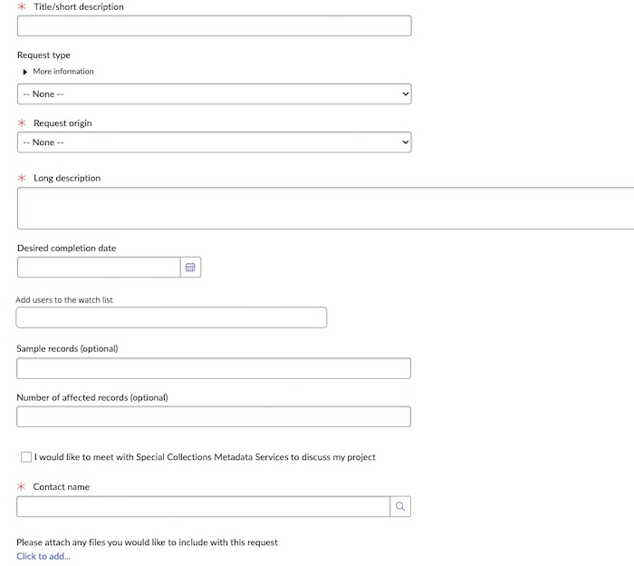

#### Title/short description 
A required field that has you enter a brief description of your request. This should be a short but descriptive summary of your request.

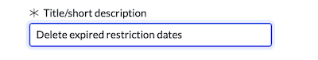

#### Request type 
An optional field that has you select the type of request from the drop-down. A brief guide can be viewed on the form under ‘More information’. If you would like more detailed descriptions and examples, please see Request Types for more information. 

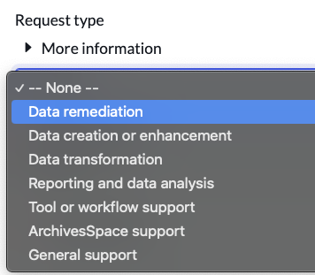

#### Request origin
A required field that has you select your department or unit from the drop-down menu. If you do not see your department or unit, select ‘Other’ and a free-text field will appear where you can enter your department or unit name.

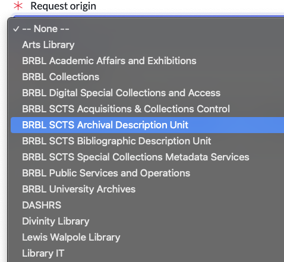

#### Long description 
A required field where you describe your request in as much detail as possible. Please add any and all relevant information within this box. Links to external resources can be added here or added to the attachments field down below. 

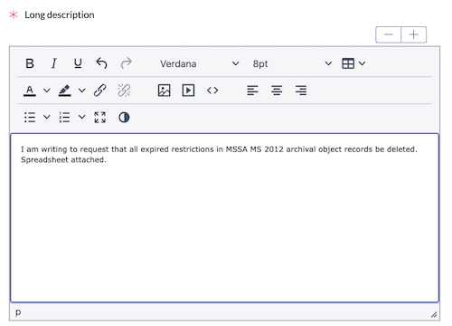

#### Estimated Records 
An optional field where, if possible, you can provide us with an idea of how many records are affected by your issue or request. This helps our Specialists to determine how large your request is. 

#### Sample Records 
An optional field where, if possible, you can provide any URIs or IDs for records that are examples of the request. This can be very helpful to help our Specialists to understand your request. 

#### Attachments
Attach any relevant files, e.g. project plans/proposals, spreadsheets. Please consider attaching over linking to avoid complications with access permissions creating delays in the work. 

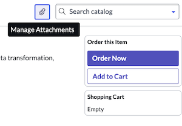

#### Desired completion date 
An optional field where you can add a desired completion date if you have a high-priority request. Please allow at least two weeks for completion of your request. We will communicate on timeline once your request is received and triaged.

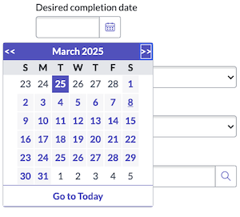

#### Contact name 

A required field where you enter your netID in this field and your name will populate. 

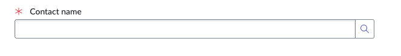

#### Watch List 

An optional field where you can add one or multiple users to the watchlist of a ticket upon submission. Enter their netID or search for someone’s name to add them. Users added to the watchlist of a ticket will be able to view the ticket in their ticket lists. 

#### Meeting Request 

An option checkbox you can select if you would like to arrange to have a ZOOM meeting before a Metadata Specialist begins work on your ticket. A Specialist will send an invitation to meet before they begin any work. Please note that it may take up to two weeks before a Specialist is assigned to your ticket and there may be further delays before meeting due to scheduling conflicts. 

#### Submit request 
Click the ‘Order Now’ button to submit your request 

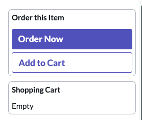

## Submitting a Request Via Email 

Requests can be submitted via scms.request@yale.edu. Sending an email to this address will let us know you wish to submit a ticket and we will open one for you based on the contents of your email. Please note that this will cause a slight delay in the creation of your ticket. 

## Viewing your open tickets 

You can view a ServiceNow request by navigating to the [SCMS SharePoint](https://yaleedu.sharepoint.com/sites/YaleSpecialCollections/SCTS/SitePages/Special-Collections-Metadata-Services-Unit.aspx) page and clicking on the ‘ServiceNow Tickets’ button on the right hand side of the page, or by navigate to [Yale ServiceNow: My Items](https://yale.service-now.com/it?id=my_items).  

Here you can view all your active, closed, at watched ServiceNow tickets – including SCMS, LSP, and LIT tickets. You can also communicate with SCMS staff and add attachments to your tickets. You can also add colleagues (e.g. supervisor, collaborator) to your ticket’s watch list.

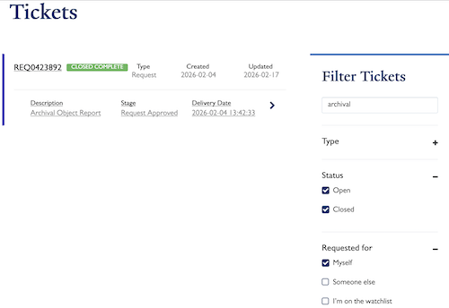
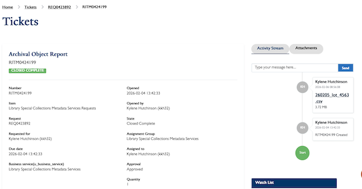
