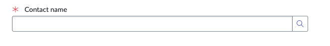
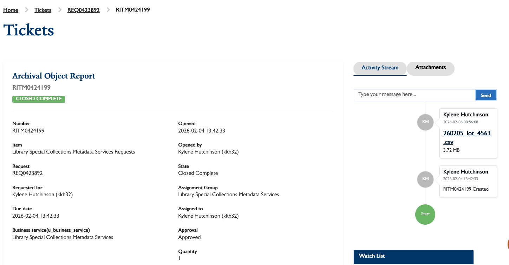

# Troubleshooting 

## Incident Tickets 
Incident Report Tickets arrive when requests are submitted via email (scms.requests@yale.edu). They require someone to address the Incident quickly, otherwise it will email reminders to the entire SCMS-ServiceNow mailing list every day or so. 

To turn an Incident Response into a REQ, you will need to cancel the INC and create a new REQ that is linked to it. 
1. Open the INC and right click on the Incident number at the top of the ticket. 
2. Select ‘Create Request’ 
3. You will be redirected to the ServiceNow form, fill out the request in the form and make sure to fill out the contact name for the original requester. 
4. This will create a REQ linked to the INC. 

## Submitting Tickets for Others 
Sometimes staff will contact us via email or teams or even in person to request help. Specialists should encourage individuals to submit a ticket form whenever possible. If for some reason the individual is unable to submit the ticket themselves, you can submit a ticket on their behalf. 

Fill out the ServiceNow form with the appropriate information. For the contact name, select the original requester instead of yourself. Then submit the form.

 

## Accessing Tickets 
Sometimes users will claim they are unable to download attachments or cannot send a reply. Likely these users are only interacting with their ticket via the message alert emails. Direct your user to the ticket viewing page (https://yale.service-now.com/it). 

This site includes tickets for SCMS, LSP, and IT. Essentially any Yale unit using ServiceNow should have their tickets available for review here. 

Users can view Open, Closed, and tickets they’re on the Watch List for using the filter options. Upon selecting a ticket, the user will be able to see basic information about their ticket on the left, and have a communications panel on the right. The panel has two tabs: Activity Stream and Attachments. The Activity Stream is where users can reply to comments and see actions taken on the ticket. The Attacment tab is where users can download files or upload their own. 
 